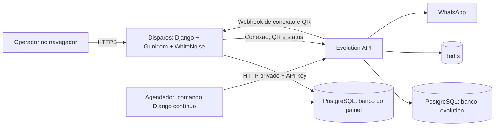

# Disparos — comunicação inicial com pacientes

Projeto independente para organizar o envio de uma mensagem inicial personalizada pelo WhatsApp a pacientes de uma clínica odontológica. A aplicação importa uma planilha, permite revisar os destinatários e executa uma programação de tentativas com histórico persistente e proteção contra repetição.

O foco atual é uma tarefa delimitada: iniciar o contato e deixar a continuidade da conversa com a equipe, no próprio WhatsApp. Não há IA, agendamento de consultas, leitura de respostas ou caixa de entrada no fluxo ativo.

> Uma tentativa automática por paciente/número, permanentemente. Falhas, timeouts, reinícios e reimportações não liberam uma nova tentativa automática. Aceitação pela Evolution não comprova entrega ou leitura.

## Objetivo e decisões de produto

A necessidade foi transformar uma base de pacientes em uma rotina de contato controlada, sem depender de copiar números e enviar mensagens individualmente durante o dia.

A solução concentra a operação em um painel: importar, revisar, selecionar, configurar, testar, iniciar e acompanhar. A simplificação do escopo permitiu priorizar a confiabilidade das tentativas e a autonomia do agendador.

Este é um projeto pessoal independente, sem vínculo com a UPSYSTEMAS. Dados de pacientes, credenciais e backups não fazem parte do material de demonstração nem devem acompanhar o repositório.

## Funcionalidades

- Importação de Excel `.xlsx` e CSV, com identificação de cabeçalhos e validação de conteúdo.
- Busca de pacientes por nome, telefone ou ID e filtros por grupo e situação na fila.
- Seleção individual e em lote dos destinatários.
- Revisão de nomes e telefones, preservando o telefone original da planilha.
- Exclusão lógica de pacientes: remove da lista e de novos envios sem apagar reservas ou histórico.
- Mensagens com `{nome}` e `{primeiro_nome}`.
- Programação de horários, tamanho dos lotes e intervalo mínimo entre tentativas.
- Pausa e ativação da fila, com configuração inicialmente pausada.
- Envio manual de teste e histórico de resultados.
- Conexão do WhatsApp por QR code, utilizando Evolution API.
- Logs, autenticação e acesso operacional restrito a superusuários.
- Interface responsiva com temas claro e escuro.
- Agendador independente do navegador e do computador do operador.

## Ferramentas e tecnologias

| Camada | Ferramentas | Uso no projeto |
|---|---|---|
| Backend | Python e Django 6.1 | Regras, autenticação, ORM, migrações, formulários e páginas |
| Interface | Django Templates, HTML, CSS e JavaScript próprios | Painel sem etapa de build frontend |
| Design | Geist, Geist Mono e Phosphor Icons | Tipografia, números tabulares e iconografia |
| Banco local | SQLite | Desenvolvimento e testes locais |
| Banco na nuvem | PostgreSQL e `psycopg[binary]` | Dados compartilhados entre painel e agendador |
| Planilhas | `openpyxl` e módulo `csv` | Leitura e validação da base |
| Integração HTTP | `requests` | Cliente centralizado da Evolution |
| Segredos | `python-dotenv` e `cryptography`/Fernet | Ambiente e criptografia de credenciais no banco |
| Servidor web | Gunicorn | Execução WSGI no Linux/Railway |
| Arquivos estáticos | WhiteNoise | CSS, JavaScript e demais estáticos no processo web |
| WhatsApp | Evolution API v2.3.7, integração Baileys | Conexão por dispositivo vinculado e envio de texto |
| Infraestrutura Evolution | PostgreSQL e Redis | Persistência e cache da integração |
| Desenvolvimento local | Docker Compose | Evolution e suas dependências |
| Hospedagem | Railway | Serviços web, agendador, Evolution e bancos |
| Versionamento | Git e GitHub | Código e integração de deploy |
| Testes | Django TestCase e mocks | Regras de envio sem contatar pacientes reais |

Python 3.14 foi utilizado no ambiente local; o build acompanhado no Railway utilizou Python 3.13. As dependências estão em `requirements.txt`, com intervalos de versões, não um lockfile integral.

Celery e seu suporte a Redis continuam disponíveis como alternativa de agendamento. A implantação acompanhada usa o comando contínuo do Django, sem worker ou beat Celery. SDKs de IA presentes nas dependências pertencem ao legado e não são utilizados no fluxo atual.

## Arquitetura na nuvem



Painel e agendador executam o mesmo código em processos separados e compartilham o mesmo banco. A Evolution usa um banco lógico separado, criado no mesmo serviço PostgreSQL; isso não representa isolamento por servidor ou por usuário de banco.

O serviço Disparos tem domínio público HTTPS. Evolution, PostgreSQL, Redis e Agendador não precisam de domínio público para a operação descrita. O painel acessa a Evolution pela rede privada; o webhook usa o endereço configurado em `URL_PUBLICA`.

## Como uma tentativa é processada

1. O operador importa a planilha. Os registros passam a existir no banco; o agendador não relê o arquivo original.
2. A equipe revisa e seleciona os pacientes, salva a mensagem e a programação com a fila pausada.
3. Após teste e conferência, a equipe inicia a fila.
4. O agendador consulta a configuração e procura um contato elegível.
5. Uma transação registra a reserva permanente do paciente e do número **antes de qualquer chamada de rede**.
6. A Evolution verifica se há registro WhatsApp para um número equivalente ao original.
7. A aplicação realiza uma única chamada de envio e registra o resultado.
8. A equipe acompanha as respostas diretamente no celular.

A consulta ao WhatsApp verifica existência do número, não a identidade do titular. Nomes vêm do cadastro; o sistema não descobre números por nome. Formatos ou DDDs inválidos exigem revisão.

### Prevenção de duplicidade

| Mecanismo | Responsabilidade |
|---|---|
| `Contato.automatico_reservado_em` | Impede outra tentativa automática para o cadastro |
| `NumeroReservado.chave` | Reserva numérica global com unicidade no banco |
| Normalização conservadora | Agrupa aliases de celulares brasileiros com e sem o nono dígito |
| Identidade de origem | Impede repetir automaticamente o mesmo paciente entre unidades após reserva |
| `Tentativa.chamada_iniciada_em` | Impede reexecutar a mesma tentativa, inclusive após redelivery |
| Transações e bloqueios | Serializam decisões concorrentes sobre configuração e reservas |
| Histórico persistente | Mantém resultados mesmo depois de falhas, exclusão lógica ou reimportação |

A estratégia privilegia evitar duplicação: uma interrupção após a reserva pode deixar uma mensagem não enviada ou incerta, que precisa de revisão humana. Não há promessa de entrega exatamente uma vez no WhatsApp.

Novas tentativas são exclusivamente manuais, quando permitidas pelas regras. Um resultado incerto exige conferir a conversa no celular. Tentativas reservadas/interrompidas exigem ao menos dez minutos antes de uma nova tentativa manual. Mensagens já aceitas não podem ser reenviadas pelo botão manual.

### Programação de referência

A configuração combinada para a operação é:

| Parâmetro | Valor |
|---|---|
| Horários | 09:00, 14:00 e 17:00 |
| Lote | Até 10 tentativas por horário |
| Intervalo mínimo | 120 segundos |
| Janela | Uma hora a partir de cada horário |
| Fuso | `America/Recife` |
| Faixa permitida | 08h às 20h |

Com processamento normal, dez tentativas iniciadas às 09h se distribuem aproximadamente entre 09h e 09h18. São até 30 tentativas diárias, não 30 entregas garantidas. Falhas de validação também consomem tentativas do lote. Não há recuperação de janelas encerradas.

**Os 120 segundos devem ser salvos no painel.** O padrão inicial do modelo ainda é 60 segundos; iniciar o agendador não modifica o cadastro existente. O modo contínuo aguarda 60 segundos após cada passo e consulta o intervalo persistido, portanto pode haver atrasos de rede e processamento.

## Organização do código

```text
config/                 Configuração Django, URLs e alternativa Celery
core/                   Clínica, unidades, criptografia, logs e políticas de admin
integracoes/            Cliente Evolution, configuração e webhook
disparos/              Fluxo ativo de importação, reserva, envio e painel
   models.py            Configuração, contatos, rodadas, tentativas e reservas
   importacao.py        Leitura e importação de Excel/CSV
   telefones.py         Normalização e equivalência de números
   services.py          Elegibilidade, reserva, validação e envio
   forms.py             Validação das configurações e cadastros
   views.py / urls.py   Operação do painel
   tasks.py             Alternativa de tarefa Celery
   management/commands/ Comandos de importação e agendamento
   tests.py             Testes do fluxo ativo
painel/                 Componentes e telas compartilhadas
atendimento/            Código histórico preservado e desativado no fluxo atual
templates/disparos/     Templates do produto atual
static/                 CSS, JavaScript, ícones e imagens
railway.json            Inicialização web no formato legado Railway
railway.agendador.json  Referência de configuração legada do agendador
DEPLOY.md               Procedimentos operacionais e histórico de infraestrutura
```

## Executando localmente

Exemplo em PowerShell, dentro da pasta do projeto. É necessário Python compatível com as dependências e Docker Desktop para a Evolution local.

```powershell
python -m venv .venv
.venv\Scripts\python -m pip install -r requirements.txt
Copy-Item .env.example .env
```

Preencha `.env` antes de executar Django. Gere segredos próprios; não utilize valores de exemplo em produção. A chave Fernet pode ser gerada com:

```powershell
.venv\Scripts\python -c "from cryptography.fernet import Fernet; print(Fernet.generate_key().decode())"
```

As variáveis obrigatórias são `DJANGO_SECRET_KEY`, `CHAVE_CRIPTOGRAFIA` e `WEBHOOK_TOKEN`. Para desenvolvimento com Evolution em Docker, use `URL_SITE=http://localhost:8000`, `URL_PUBLICA=http://host.docker.internal:8000` e inclua `host.docker.internal` em `DJANGO_ALLOWED_HOSTS`.

```powershell
.venv\Scripts\python manage.py migrate
.venv\Scripts\python manage.py createsuperuser
.venv\Scripts\python manage.py runserver 0.0.0.0:8000
```

Cadastre a clínica e a unidade pelo admin. O comando `dados_iniciais` é opcional e cria cadastros de demonstração, incluindo dados do legado; não representa a configuração real de uma clínica.

Em outro terminal:

```powershell
docker compose -f docker-compose.evolution.yml --env-file .env up -d
```

Configure em Integrações a URL `http://localhost:8080` e a chave usada no compose. Conecte o WhatsApp da unidade pelo QR code. Para testar a operação agendada local:

```powershell
.venv\Scripts\python manage.py processar_disparos --continuo
```

Esse comando pode enviar mensagens reais quando a fila estiver ativa, dentro da programação e com destinatários elegíveis. Use dados fictícios e mantenha a fila pausada durante a preparação. Não rode simultaneamente com beat ou cron. `iniciar_dev.ps1` já inicia worker/beat e é uma alternativa ao modo contínuo, não um complemento.

## Formato da planilha

Cabeçalho de referência:

```csv
ID interno;Nome;Celular;Grupo;Prontuário;Situação
DEMO-001;Paciente Exemplo;;Demonstração;DEMO-001;Ativo
```

O telefone foi deixado vazio propositalmente; o registro irá para revisão. Arquivos de demonstração não devem conter números reais de terceiros.

Limites: até 10 MB de arquivo, até 20.000 pacientes e proteção contra XLSX descompactado excessivamente grande. Fórmulas são rejeitadas. O ID de origem é recomendado para manter a identidade nas reimportações; sem ele, um número válido é necessário para gerar uma identidade baseada no telefone.

A reimportação não remove ausentes, não limpa reservas e não restaura excluídos. A integração atual utiliza a planilha exportada: não há sincronização automática com o Dentista Organizado.

## Como o projeto foi colocado na nuvem

A hospedagem acompanhada foi feita no **Railway**, com o código no GitHub e serviços separados dentro do mesmo projeto. Não foi necessário manter o computador local ligado. O ambiente começou no período de teste do Railway; isso não representa hospedagem gratuita permanente.

### 1. Código e serviço web

O repositório `arruttor/Disparos`, branch `main`, foi conectado ao Railway para gerar o build do serviço **Disparos**. Foram corrigidas duas dependências de publicação: Gunicorn para iniciar o servidor WSGI e WhiteNoise para servir estáticos depois da coleta.

O comando web realiza, nesta ordem:

```bash
python manage.py collectstatic --noinput
python manage.py migrate --noinput
```

Depois inicia:

```bash
exec gunicorn config.wsgi:application --bind 0.0.0.0:${PORT:-8080} --workers 1 --access-logfile - --error-logfile -
```

O `railway.json` contém essa sequência em um único `sh -c`, encadeada com `&&`. Se coleta ou migração falhar, o servidor não é iniciado. O domínio público deve encaminhar para a porta efetivamente usada pelo processo.

### 2. Variáveis e PostgreSQL persistente

Os segredos foram cadastrados no Railway, sem copiar `.env` para o repositório. Hosts e origens foram ajustados ao domínio público:

| Variável | Conteúdo esperado |
|---|---|
| `DJANGO_ALLOWED_HOSTS` | Hostname, sem `https://` |
| `DJANGO_CSRF_TRUSTED_ORIGINS` | Origem completa com `https://` |
| `URL_SITE` | Endereço público do painel |
| `URL_PUBLICA` | Endereço acessível pela Evolution para o webhook |
| `DJANGO_SECRET_KEY` | Segredo Django próprio |
| `CHAVE_CRIPTOGRAFIA` | Chave Fernet preservada entre deploys |
| `WEBHOOK_TOKEN` | Token próprio de autenticação do webhook |

`DJANGO_DEBUG` ficou temporariamente ligado por decisão do operador durante a implantação. Para a configuração final de produção, recomenda-se desligá-lo após diagnóstico; este README não altera o ambiente remoto.

O serviço **Postgres** foi criado com volume e conectado ao Disparos por referências privadas:

```dotenv
DATABASE_NAME=${{Postgres.PGDATABASE}}
DATABASE_USER=${{Postgres.PGUSER}}
DATABASE_PASSWORD=${{Postgres.PGPASSWORD}}
DATABASE_HOST=${{Postgres.PGHOST}}
DATABASE_PORT=${{Postgres.PGPORT}}
```

O backend lê essas cinco variáveis; cadastrar somente `DATABASE_URL` não troca o SQLite pelo PostgreSQL. As migrações criam as tabelas no banco selecionado, mas não copiam dados de outro banco. Na implantação acompanhada, o operador confirmou que só havia criado um administrador; o acesso foi recriado depois da troca.

No console Railway, o executável usado foi:

```bash
/app/.venv/bin/python /app/manage.py createsuperuser
```

### 3. Evolution e Redis

Foi criado um serviço de imagem Docker com `evoapicloud/evolution-api:v2.3.7`, além do serviço Redis com volume. No PostgreSQL existente, criou-se o banco lógico separado `evolution`:

```bash
psql -U "$POSTGRES_USER" -d "$POSTGRES_DB" -c 'CREATE DATABASE evolution;'
```

A conexão da Evolution aponta especificamente para esse banco, enquanto o Django continua no banco do painel. As variáveis principais usadas na Evolution foram:

```dotenv
SERVER_TYPE=http
SERVER_PORT=8080
SERVER_URL=http://${{RAILWAY_PRIVATE_DOMAIN}}:8080
AUTHENTICATION_API_KEY=${{Disparos.EVOLUTION_API_KEY}}
DATABASE_PROVIDER=postgresql
DATABASE_CONNECTION_URI=postgresql://${{Postgres.PGUSER}}:${{Postgres.PGPASSWORD}}@${{Postgres.PGHOST}}:${{Postgres.PGPORT}}/evolution?schema=public
DATABASE_CONNECTION_CLIENT_NAME=evolution
DATABASE_SAVE_DATA_INSTANCE=true
DATABASE_SAVE_DATA_NEW_MESSAGE=false
DATABASE_SAVE_MESSAGE_UPDATE=false
DATABASE_SAVE_DATA_CONTACTS=false
DATABASE_SAVE_DATA_CHATS=false
DATABASE_SAVE_DATA_LABELS=false
DATABASE_SAVE_DATA_HISTORIC=false
CACHE_REDIS_ENABLED=true
CACHE_REDIS_URI=${{Redis.REDIS_URL}}
CACHE_REDIS_PREFIX_KEY=evolution
CACHE_LOCAL_ENABLED=false
WEBHOOK_GLOBAL_ENABLED=false
TELEMETRY_ENABLED=false
LANGUAGE=pt-BR
```

`EVOLUTION_API_KEY` precisa existir no serviço Disparos para a referência acima funcionar. O Django não lê essa variável para configurar a integração: a mesma chave e a URL são salvas pelo painel. Senhas com caracteres especiais precisam de codificação adequada ao montar URIs; não copie credenciais para logs ou documentos.

No painel, a URL utilizada foi `http://evolution-api.railway.internal:8080`. A porta é necessária: omiti-la faz o cliente tentar a porta 80. O WhatsApp foi vinculado pelo celular e o operador confirmou o recebimento de uma mensagem de teste.

O compose local prevê volume em `/evolution/instances`. Na implantação remota acompanhada, foram confirmados volumes do Postgres e Redis, mas não a montagem desse volume na Evolution. Conferir a persistência da sessão antes de depender de reinícios transparentes; pode ser necessário novo QR code.

### 4. Agendador separado

Um segundo serviço **GitHub Repo**, apontando para o mesmo repositório e branch, foi criado como **Agendador**. Seu comando foi configurado diretamente em **Settings → Deploy → Custom Start Command**:

```bash
python -u manage.py processar_disparos --continuo --exigir-postgres
```

Ele não inicia Gunicorn nem precisa de domínio público. Deve ter uma réplica, Serverless desligado, nenhum Cron Schedule ou healthcheck HTTP e política de reinício apropriada ao processo contínuo. `--exigir-postgres` impede iniciar acidentalmente com SQLite isolado.

As referências de ambiente do Agendador são:

```dotenv
DJANGO_SECRET_KEY=${{Disparos.DJANGO_SECRET_KEY}}
CHAVE_CRIPTOGRAFIA=${{Disparos.CHAVE_CRIPTOGRAFIA}}
WEBHOOK_TOKEN=${{Disparos.WEBHOOK_TOKEN}}
DJANGO_DEBUG=${{Disparos.DJANGO_DEBUG}}
URL_PUBLICA=${{Disparos.URL_PUBLICA}}
URL_SITE=${{Disparos.URL_SITE}}
DATABASE_NAME=${{Disparos.DATABASE_NAME}}
DATABASE_USER=${{Disparos.DATABASE_USER}}
DATABASE_PASSWORD=${{Disparos.DATABASE_PASSWORD}}
DATABASE_HOST=${{Disparos.DATABASE_HOST}}
DATABASE_PORT=${{Disparos.DATABASE_PORT}}
```

Foi confirmada pelo operador a inicialização com:

```text
Agendador iniciado: uma verificação por minuto. A pausa e a programação do painel serão respeitadas.
Nenhuma tentativa elegível neste momento.
```

Esses logs confirmam a inicialização e um ciclo sem tentativa elegível; não comprovam execução completa de uma campanha. O indicador no painel utiliza a última execução registrada no banco.

**Atenção ao formato de configuração Railway:** a tentativa inicial usava `/railway.agendador.json`, mas o painel informou que serviços novos não podiam aderir ao Config as Code legado. A implantação seguiu pelo Custom Start Command. Os arquivos JSON permanecem no repositório como referências; não são uma receita universal para serviços novos. A documentação consultada informa encerramento da leitura do formato legado em 01/12/2026. Para novos ambientes, use as configurações do painel ou migre para o formato atual de infraestrutura. [Documentação Railway](https://docs.railway.com/infrastructure-as-code).

### 5. Verificação e ativação

Com a fila pausada, verificar login, CSS/JS, banco compartilhado, conexão WhatsApp e atividade recente do agendador. Revisar pacientes e mensagem, salvar lote 10/intervalo 120 s e só então iniciar a fila.

Os serviços precisam permanecer em execução para a programação funcionar. Fechar o navegador não interrompe o processamento; desligar o serviço Agendador ou suas dependências impede a operação. Não há medição de retorno comercial ou comprovação de uma campanha completa neste README.

## Testes e verificações

```powershell
.venv\Scripts\python manage.py test --noinput
.venv\Scripts\python manage.py check
.venv\Scripts\python manage.py makemigrations --check --dry-run
```

A última verificação da implementação registrou **217 testes passando no SQLite**, incluindo o fluxo atual e regressões do legado explicitamente isoladas. Há cobertura para reserva antes da rede, normalização, reimportação, exclusão lógica, falhas, timeout, repetição de tarefa, permissões, estáticos e programação simulada de três lotes com 120 segundos.

As chamadas de envio nesses testes usam mocks. Isso não substitui testes de concorrência em PostgreSQL nem confirma entrega real pelo WhatsApp.

## Limitações e cuidados operacionais

- A conexão Baileys utilizada não é a API oficial da Meta e não oferece garantia contra bloqueio de conta. Intervalos não tornam um envio automaticamente autorizado ou seguro.
- O sistema não consulta a lista de bloqueados no celular da clínica. Para impedir tentativas para um paciente, retire-o da fila ou exclua-o também no painel.
- Respostas e mensagens comuns do celular são ignoradas pelo fluxo atual. Pedidos de saída precisam ser atendidos pela equipe e refletidos na base.
- Excluir pelo painel não elimina definitivamente os dados: histórico e reservas são mantidos.
- Não existe garantia de entrega, leitura, titularidade do número ou disponibilidade contínua da plataforma.
- A pausa não desfaz uma chamada já iniciada. Um resultado incerto deve ser conferido no celular antes de qualquer nova tentativa manual.
- Backups devem preservar o banco completo e a chave Fernet. Restaurar um backup antigo sem reconciliar tentativas pode permitir mensagens repetidas.
- O webhook atual usa token na query string; tratar URLs e logs como sensíveis e controlar sua retenção.
- A implementação tem clínica/unidades, mas não deve ser apresentada como SaaS multiempresa com isolamento completo entre clientes.
- O projeto não publica automaticamente uma auditoria de privacidade ou conformidade; uso real exige autorização de contato, gestão de acesso e tratamento apropriado dos dados.

## Evolução do escopo

O repositório nasceu com atendimento por IA, Google Agenda e lembretes. O produto foi simplificado para somente a mensagem inicial. Código e migrações antigos foram preservados para manter dados e regressões; rotas, tarefas e funções operacionais antigas possuem guardas no modo de disparos.

A presença de módulos históricos não significa que essas funcionalidades estejam disponíveis no produto atual. O README descreve o fluxo ativo; o histórico técnico está em `AGENTS.md` e `DEPLOY.md`.

## Documentação complementar

- `DEPLOY.md`: operação, atualização, persistência e histórico do deploy.
- `AGENTS.md`: regras de manutenção, limites do escopo e decisões técnicas.
- `.env.example`: nomes das variáveis de ambiente; deve ser preenchido com valores próprios.
- `requirements.txt`: dependências do projeto.

Documentação atualizada em **05/11/2026**, com base no código e nas validações relatadas pelo operador. Não contém credenciais nem dados reais de pacientes.
